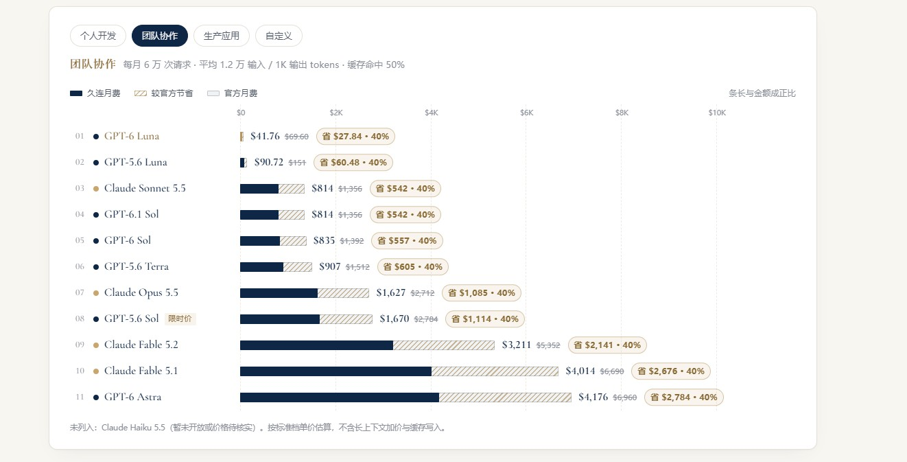

# Claude 国内代充全攻略（2026）：微信/支付宝直付的充值服务，5 分钟开通 Pro/Max，不用境外信用卡

---

## 一、为什么"代充"会成为国内用户开通 Claude 的主流方式

Anthropic 的官方支持地区名单不含中国大陆，也含香港、澳门。这意味着 claude 国内充值从一开始就要绕开三层门槛：

1. **支付层**：Claude 订阅只收境外发行的信用卡 / 部分地区的 App Store 内购。国内用户最常见的死因不是不想付费，而是开卡（虚拟卡、外币卡）环节反复失败。
2. **账号层**：从未用银行卡开过会员的 Free 账号、注册没几天的新号，很多代充渠道不给开 Max，或要求先"养号"3–15 天。
3. **风控层**：Claude 的风控在 2026 年明显加严——9 月 14 日额度净减约 17%、10 月底出现一波核验与停用报告、KYC（身份验证）触发率上升。这些官方动作反过来放大了对"谁来帮我付费才安全"的焦虑。

代充就是卡在这三层门槛之间的生意：**用人民币付款，由平台替你在官方后台完成订阅开通，订阅最终开在你自己的 Claude 账号上**。三个站点都把"无需境外信用卡、支付宝/微信直接付、几分钟到账"放在最显眼的位置。

在中文语境里，这件事有一长串叫法：claude 国内充值、claude 代充值、claude pro 充值、claude pro 代充、claude 代充值服务……搜到的其实都是同一类生意的不同说法与不同形态。本文统一用"代充"这个词，并在对应位置注明各家站点的原始叫法与差异。

如果你已经确认账号处于 Free 状态、只想直接开通，可以 [**立即充值**](https://9linkai.com/register?aff=BASHIGE) 完成注册下单；想先弄清三家站点的差异、价格与风险，再往下读。

---

## 二、三个站点速览

### 1. claudo.org —— Claude Pro 代充和注册服务

- **定位**：面向国内个人用户的 Claude Pro 代充，¥189/月，官方流程直充。
- **数据展示**：历史用户 2,600+、平均到账约 5 分钟、充值成功率 99%（站方自述口径）。
- **付款方式**：支付宝、微信、对公转账。
- **客服**：人工在线，工作时间 10:00–21:00（周六日休息），响应一般 30 分钟内，24 小时内会通过好友申请。
- **特色**：附赠《Claude 注册教程（90% 成功）》，没有账号的用户可以按教程自行注册后再充值；同时声称支持 Grok、ChatGPT、Gemini、Cursor 等多种 AI 服务代充。
- **现状**：其购买页（/purchase）目前显示"系统维护中"，恢复时间以页面通知为准；维护期间站方把用户导向 ChatGPT 充值（upchatgpt.com）和 Grok 开通（grokng.com）。

### 2. upclaude.com —— Claude Pro 专业代充服务

- **定位**：卡密模式的 Claude 代充值服务，只做 Claude Pro 这一档，¥189/月，1 分钟下单、2–10 分钟激活。
- **付款方式**：支付宝、微信支付，人民币直接付款。
- **客服**：右下角扫码加微信客服，工作时间 9:00–24:00（节假日不休），通常 15 分钟内响应。
- **运营主体**：页脚标注 NEXCLOUD TECHNOLOGY LIMITED（香港火炭）。claudo.org 未标注主体，但两家页面结构、话术与 FAQ 高度相似，均指向同一个"ChatGPT 充值"引流入口（getgpt.pro / upchatgpt.com）。
- **商品**：只做两样——Claude Pro 充值（¥189/月）和 Claude 普通账号（全新、不带任何会员，登录即用）。**明确不支持 Max 充值**。
- **特色**：六步图文教程（检查账号→付款→拿卡密→复制 Organization ID→提交激活→确认生效），FAQ 覆盖 19 个问题，风险披露写得很直白。

### 3. claudemax.shop —— ClaudeMax：代付平台 + 内容站

- **定位**：与前两家不同，ClaudeMax 是目前商品线最全的一站式 claude 代充值平台——"代付订阅平台 + 重度内容站"的组合：自 2024 年 11 月运营、自述累计服务 20,000+ 用户，首页挂着 275 篇博客，覆盖套餐选购、封号风控、KYC、企业采购、模型评测。
- **商品线最全**：Claude Pro、Max 5x（现已更名 Max）、Max 20x（现已更名 Ultra）、Max 6.25x 成品号（实为 Team 方案 Premium 席位账号）、ChatGPT Plus / Pro 100 / Pro 200 / Pro 500、Grok、Meta Muse 等。
- **两种交付**：**代充**（提交登录凭证或 Cookie，先预检后付款，5–30 分钟开通在你自己的账号上）与**成品号**（已开通对应档位的账号，付款后验证收件邮箱，人工发货 30 分钟到 4 小时，可绑定自己的邮箱）。
- **面向企业**：支持对公转账与发票（境外凭证、无增值税发票），有企业采购、席位配档、离职交接、数据合规等专门内容。
- **客服**：8:00–23:00 在线客服。---

## 三、什么是 Claude 会员代充：三种模式一张表

综合三家站点，"Claude 会员代充"实际上分三种交付形态（代充到自有账号、claude 成品号、普通账号），各有适合的人群：

| 模式 | 代表站点 | 你要提供什么 | 交付结果 | 适合谁 |
|---|---|---|---|---|
| **代充到自己账号** | claudo.org、upclaude.com、claudemax.shop | 卡密 + Organization ID（upclaude / claudo），或登录凭证 / Cookie（claudemax） | 订阅开在你自己的账号上，聊天记录、Projects 全部保留 | 已有 Claude 账号、想保留数据的人 |
| **成品号（claude 成品号）** | claudemax.shop | 收件邮箱 + 点验证邮件 | 已开通 Pro / Max 的现成账号，可改绑邮箱、改密码 | 新号、没开过会员的号、想要独立工作号的人 |
| **普通账号** | upclaude.com | 无 | 全新 Free 账号（不含会员） | 只需要一个干净账号自己折腾的人 |

**关键共性**：三家都强调"全程不需要提供 Claude 账号密码"。upclaude 和 claudo 只需要你在 claude.ai/settings/account 页面复制的 **Organization ID**；claudemax 的代充需要提交登录凭证或 Cookie 做预检，但预检通过后才付款。

---

## 四、价格：官方美元价与代充人民币价

按三家站点披露的信息（2026 年 11 月口径）：

**官方定价**：Claude Pro $20/月；Max 5x $100/月；Max 20x $200/月。2026 年 11 月 10 日起官方把 Max 5x / 20x 更名为 **Max / Ultra**。Max 5x / 20x 自 10 月 8 日起每月附送 $100 / $200 的 Claude API 额度（满 7 天后在 claude.ai 绑定 Console 组织领取，不含 Claude Code，每个计费周期清零）。

**代充价**：claudo.org 与 upclaude.com 的 claude pro 代充价均为 **¥189/月**；claudemax 的各档价格每小时读自下单系统，页面实时显示。按官方 $20 折算，¥189 大约对应 7.5–7.8 的汇率区间——代充价通常低于按官方汇率折算的人民币价，差价来自支付通道成本与批量开通。也可以直接在 [9linkai 注册充值入口](https://9linkai.com/register?aff=BASHIGE) 查看实时价格与套餐。

**结算特点**：
- 一次性充值，不绑定信用卡，**不会自动扣费**。到期自动变回 Free，需要续费时重新下单。
- claudo.org 另支持对公转账；claudemax 面向企业提供对公转账 + 发票（境外 Invoice 凭证，可勾选公司抬头，无增值税发票）。
- upclaude 个人用户可在"订单查询"页导出 Receipt 收款凭证用于报销。

---

## 五、完整流程拆解（以 upclaude 的六步教程为蓝本）

upclaude.com 的教程页给出了目前最完整的操作链路，预计 10–15 分钟完成：

1. **检查账号状态**：登录 Claude，打开账户设置与 Billing 页面，确认套餐显示为 **Free**，且没有 overdue 欠款。仍在 Pro / Max 有效期内不要下单（重复下单不增加额度，卡密充不进去损失概不负责）。
2. **填手机号并付款**：在购买页填写日常手机号（仅用于订单查询和通知），勾选风险说明，支付宝/微信付款。
3. **获取卡密**：支付成功后系统即时发放卡密。卡密未使用一直有效，**一经核销无法退款**，也不要发给他人。
4. **复制 Organization ID**：打开 claude.ai/settings/account，复制账户信息里的 Organization ID。注意**不是** API 控制台的组织 ID——填错会导致核销后充不到目标账号。
5. **提交激活**：在充值网站粘贴卡密 + Organization ID，提交后不要反复切换账号，处理通常需 2–10 分钟，高峰期更久。
6. **确认生效**：如果充值完成但 Claude 仍显示 Free，是官方缓存问题——退出账号重新登录即可看到 Pro 状态；仍未生效就保留订单号和截图找客服。

claudo.org 的三步流程与之同构：验证充值码 → 获取并填写 Claude 用户 ID → 复制 Organization ID 回填直充。claudemax 的代充则多一步**预检**：在下单页提交 claude.ai 的 Cookie，系统先校验账号状态（是否 Free、能否开对应档位），预检通过再付款，通常 5–30 分钟开通。

**续费逻辑**：三家一致——等到期变回 Free 后再重新下单，不要在 Pro 有效期内提前充值。

---

## 六、下单前必须知道的额度与档位知识

三家站点的内容共同拼出了 2026 年下半年 Claude 的额度版图，这些知识直接决定你该买哪一档：

- **共用额度池**：网页、桌面、手机和 Claude Code 共用一份额度，5 小时滚动重置，付费档另有每周上限。
- **9 月 14 日额度变化**：Anthropic 官方把每周标准额度永久 +25%，但 5 月起的临时 +50% 同时结束，净减约 17%。Pro / Max / Team 全部受影响。
- **档位怎么选**：Pro 就含 Claude Code；每周被限流 3 次以上再考虑 Max；Max 5x 和 20x（现 Max / Ultra）功能完全相同，只差额度（每会话为 Pro 的 5 倍 / 20 倍）。
- **Fable 系列**：Fable 5.1 / 5.2 是最高能力档，Max 用户最多用到每周额度的 50%；Pro 用户从第一条消息起就走 usage credits。
- **新模型**：9 月下旬 Opus 5.5（成本比 Opus 5 低 40%）与 Sonnet 5.5（比 Sonnet 5 快 30%+）发布，Pro / Max 默认模型已切换，5 小时额度上调，并送一次可保存的额度重置。
- **代充的档位限制**：想办理 claude max 代充值（即给已有账号开通 Max / Ultra），先要过账号资格这一关——claudemax 明确"从没用银行卡开过会员的 Free 账号不能充 Max，新号 3–15 天后才能充 Max 20x"；upclaude 和 claudo 则干脆只做 Pro。想上 Max / Ultra 的用户，claudemax 给出的替代路径是 **Max 6.25x 成品号**——实为 Claude Team 方案的 Premium 席位账号，每 5 小时会话约为 Pro 的 6.25 倍，商业方案默认不用你的内容训练模型，不挑账号、当天到手。

---

## 七、风险清单：三家站点都写明的几条红线

这部分是三个站点披露最一致、也最值得逐字读的内容：

### 1. 封号风险（自担）
- upclaude 原话：充值后"约 95%+ 正常"，但 Claude 风控较严，与支付方式无关，少数账号可能受影响；"无论充值成功后多久发生（包括几小时、当天等），均不退款。如果无法接受此风险，请不要下单。"
- upclaude 另一处引用的数据：非完全统计，Claude 大陆账号月封号率约 2%+，"封号几乎是概率问题而非偶然"。
- claudo 的 FAQ 则把 KYC 风险前置：**下单前账号必须已完成 KYC 且验证通过**，未完成或未通过 KYC 的账号提交升级"大概率触发 KYC 或会员无法到账"，相关情况无法售后、无法退款。

### 2. KYC（身份验证）
- 近期 Claude 的身份验证检查明显增加，部分账号充值后会遇到 "Verify your identity"。
- KYC 本质是 Anthropic 对账号的实名验证，需要本人持证件（护照、驾照或身份证）配合，**没有任何代充站能代办**——claudo 直接写明"KYC 须自行完成，本站无法协助；无法解决者无需咨询客服"。
- 建议：下单前先了解 Persona 验证流程、准备好证件材料；是否触发无法提前预估，因未通过或不愿验证导致账号无法使用的，三家均不退款。

### 3. 账号状态门槛
- 非 Free 状态不能充（需等订阅到期回到 Free）。
- 有信用卡自动续费欠款（overdue）不能充——先在 Claude 设置 → Billing 取消订阅/自动续费、清掉 outstanding balance 再下单。
- 没开过会员的账号、太新的账号充不了 Max。

### 4. 退款规则
- **卡密未使用**：可退款（claudo 承诺"充值失败，支持退款"，upclaude 承诺未激活的卡密退款）。
- **卡密已核销**：一律不退——upclaude 的解释是 iOS 礼品卡订阅渠道他们自己也收不到退款。
- **封号**：不属于退款范围，三家口径一致。
- 官方渠道本身的规则则是另一套：升级立即按比例计费、降级到期不退差、除 EEA/UK 14 天外基本没有退款。

### 5. 环境因素
Claude 的风控维度包括账号环境、IP 质量、VPN 跳变、账号年龄、使用行为等，与支付方式无关。claudemax 的博客专门提醒：固定出口 IP、避免频繁切换地区、不要多人共享同一账号（条款禁止共享凭证，额度按账号分摊、聊天记录全员可见）。

---

## 八、高频 FAQ 汇总（来自 claudo.org 与 upclaude.com）

**Q：能充 Max 套餐吗？**
upclaude / claudo：不支持，只做 claude pro 充值 + 普通账号。需要 Max / Ultra 走 claudemax 一类的成品号或代充（有账号资格门槛）。

**Q：充值需要账号密码吗？**
不需要。只需在 claude.ai/settings/account 复制 Organization ID。

**Q：充值成功但还显示 Free？**
官方缓存问题，退出重新登录即可；仍不行联系客服排查。

**Q：现在不是 Free 状态能充吗？**
不能。等订阅到期回到 Free 再下单，叠加充值会导致卡密充不进去。

**Q：有 overdue 欠款能充吗？**
不能。先取消自动续费、清掉欠款、回到 Free 再来。

**Q：充值后会自动续费吗？**
不会。一次性充值，不绑卡，到期自动回 Free。

**Q：能开发票吗？**
upclaude：个人可导出 Receipt 收款凭证报销，暂不支持增值税发票。claudemax：支持境外 Invoice、可勾选公司抬头，面向企业可对公。

**Q：多久能完成？**
卡密即时发放，激活通常 2–10 分钟（claudo 口径 2–5 分钟，高峰期可能更久）。

**Q：被封号了怎么办？**
Claude 风控维度多样，此价格不含售后质保，无论何时发生均不退款——三家口径一致，这也是该类服务最核心的免责条款。

**Q：触发 KYC 怎么办？**
本人按官方流程完成验证（准备护照等材料），任何代充站都无法代办；因未通过或不愿验证导致账号不能用的，不退款。

---

## 九、代充 vs 成品号 vs 自己开卡 vs API：怎么选

把三家站点给出的判断标准合并成一张决策表（按表选好路径后，可[前往充值平台下单](https://9linkai.com/register?aff=BASHIGE)）：

| 你的情况 | 建议路径 |
|---|---|
| 已有 Claude 账号、能正常登录、当前 Free、只想用 Pro | 卡密 claude pro 代充（claudo / upclaude，¥189/月，2–10 分钟） |
| 已有账号、想要 Max / Ultra、账号开过会员 | claudemax 的 claude max 代充值（Cookie 预检，5–30 分钟） |
| 新号或没开过会员、想上高档 | Max 6.25x 成品号（Team Premium 席位账号，当天到手）或先养号 |
| 不想折腾账号、要数据隔离 | 成品号（付款后验证邮箱、改密码、改绑自己的邮箱） |
| 用量很小、每月只用几天 | API 按量付费可能更省（Anthropic 官方口径：企业里 Claude Code 平均每人每月 $150–250、每活跃日约 $13；轻度用户 API 更划算） |
| 每天重度使用 | 订阅永远比 API 便宜，档位按撞限频率选 |
| 团队 / 企业 | claudemax 的对公转账 + 发票通道，配 Team 席位；注意成品号不在公司 SSO 与管理后台内，需要台账与离职交接制度补位 |

**下单前 3 分钟自查**（claudemax 的建议）：账号现在是什么状态（Free / Pro / Max）、有没有 overdue、开没开过会员、多新——这四个答案直接决定你能买哪类商品。

---

## 十、绕不开的对照组：ChatGPT 与其他替代

三家常见解站都内置了"劝退"话术，而且指向同一个替代品：

- **upclaude 专门做了对比页**："Claude 对大陆账号的风控极为严苛，封号几乎是概率问题而非偶然（非完全统计，月封号率约 2%+）。ChatGPT 的封号率则低得多（1/500 不到）——大量大陆用户连续使用两三年，从未遇到一次封号。" 它同时强调 OpenAI 的 Codex 在代码生成、Debug、工程辅助上"实测表现与 Claude Sonnet 已不相上下"，同等价格体验更稳。
- **claudo 在购买页维护期间**把用户导向 ChatGPT Plus / Pro 充值和 Grok Premium 开通。
- **claudemax 的博客**则更中性：两边都写——既有《Claude 如何使用才不会被封号》，也有《2026 年国内怎么用 ChatGPT》；结论是按 8 个用途选（写代码、长文档、Projects、Claude Code 选 Claude；联网搜索、Deep Research、生图、语音、Agent 浏览选 ChatGPT），两边都想要就 $40/月组合订。

对写代码为主的用户，三家一致的判断是：**Claude 的核心吸引力在 Claude Code 和 Opus / Fable 系列；如果你对这两个没有刚需，ChatGPT Plus 的稳定性和封号率是更省心的选择。**

---

## 十一、总结：给不同人群的落点

1. **预算敏感的个人用户**：¥189/月 的 Claude Pro 卡密代充是三个站点里最低的门槛，2–10 分钟到账、不绑卡、不自动续费，但要接受"封号不退、KYC 自理"的条款——下单前把 KYC 流程和证件准备好，能把最常见的两类损失（核销后无法退款、验证失败卡死）提前规避掉。
2. **想要 Max / Ultra 的重度用户**：优先确认自己的账号资格（开过会员、有一定账号年龄），走 Cookie 预检的代充；资格不够就考虑 Team Premium 席位成品号（Max 6.25x），按每元用量而不是名字选档。
3. **企业采购**：个人代充商品不适合直接进公司流程——账号不在 SSO 与管理后台内。走对公转账 + 发票的代付通道，配 Team 席位，把账号资产台账、离职交接、数据脱敏制度写进使用政策。
4. **所有人群共同的底线**：一人一账号、不共享凭证、固定网络环境、下单前自查账号状态（Free、无欠款、开过会员与否）、保留订单号和付款凭证。三家站点把"如果无法接受此风险，请不要下单"写在了最显眼的位置——这不是免责套话，而是这个灰度市场里最真实的风险定价。

确认完账号状态与档位后，即可 [**立即充值 Claude Pro**](https://9linkai.com/register?aff=BASHIGE)；下单前如仍有疑问，可回到第八节 FAQ 或联系对应站点客服确认。

> 最后提示：以上价格、额度、风控口径均来自三个站点的自述页面，时效为 2026 年 11 月；官方档位名（Max / Ultra 更名）、额度规则与 KYC 政策仍可能变动，下单前请以 claude.ai 官方页面与各站点下单页的实时显示为准。本文为信息整合，不构成购买建议。
